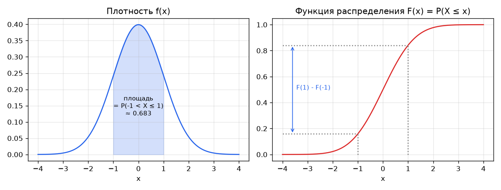
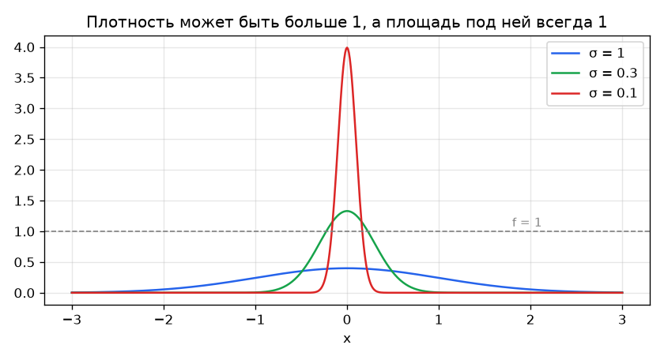

# Плотность (PDF), функция распределения (CDF) и квантили

## Три функции одного распределения

Для непрерывной случайной величины $X$:

| Что | Обозначение | Смысл | В `scipy.stats` | В `statistics.NormalDist` |
|---|---|---|---|---|
| функция распределения | $F(x) = P(X \leq x)$ | вероятность, накопленная левее $x$ | `cdf` | `cdf` |
| плотность | $f(x) = F'(x)$ | скорость роста $F$ в точке $x$ | `pdf` | `pdf` |
| квантильная функция | $F^{-1}(q)$ | такое $x$, что $P(X \leq x) = q$ | `ppf` | `inv_cdf` |

Вероятность попасть в отрезок — это площадь под плотностью:

$$
P(a < X \leq b) = \int_a^b f(x)\,dx = F(b) - F(a).
$$



## Плотность — не вероятность

$f(0) \approx 0{,}3989$ для стандартного нормального распределения **не** означает, что «$X = 0$ с вероятностью 0,4». Вероятность любой отдельной точки равна нулю. Плотность связана с вероятностью только через длину интервала:

$$
P(x < X \leq x + \Delta x) \approx f(x)\,\Delta x \quad \text{при малом } \Delta x.
$$

Например, $P(0 < X \leq 0{,}01) \approx 0{,}3989 \cdot 0{,}01 \approx 0{,}004$. Плотность — это вероятность **на единицу длины**, как плотность вещества — масса на единицу объёма.

Самый быстрый способ убедиться, что плотность не вероятность: она может быть больше единицы. У нормального распределения с $\sigma = 0{,}1$ плотность в нуле

$$
f(0) = \frac{1}{0{,}1\sqrt{2\pi}} \approx 3{,}99,
$$

при этом площадь под кривой по-прежнему равна 1: кривая высокая, но узкая.



## Формула нормальной плотности

$$
f(x \mid \mu, \sigma) = \frac{1}{\sigma\sqrt{2\pi}}\, e^{-\frac{(x-\mu)^2}{2\sigma^2}}
$$

- $\frac{(x-\mu)^2}{2\sigma^2}$ — квадрат расстояния от центра в единицах $\sigma$: плотность падает симметрично и очень быстро, как $e^{-z^2/2}$.
- $\frac{1}{\sigma\sqrt{2\pi}}$ — нормировка, чтобы площадь была равна 1. Поэтому при уменьшении $\sigma$ пик растёт: та же единичная площадь сжимается в узкую полосу.

## Таблица значений для N(0, 1)

| $x$ | $f(x)$ | $F(x)$ |
|---|---|---|
| −3,00 | 0,0044 | 0,0013 |
| −2,25 | 0,0317 | 0,0122 |
| −1,50 | 0,1295 | 0,0668 |
| −0,75 | 0,3011 | 0,2266 |
| 0,00 | 0,3989 | 0,5000 |
| 0,75 | 0,3011 | 0,7734 |
| 1,50 | 0,1295 | 0,9332 |
| 2,25 | 0,0317 | 0,9878 |
| 3,00 | 0,0044 | 0,9987 |

Полезные ориентиры: $F(1) - F(-1) \approx 0{,}683$, $F(2) - F(-2) \approx 0{,}954$, $F(3) - F(-3) \approx 0{,}997$ (правило «68–95–99,7»), $F^{-1}(0{,}975) \approx 1{,}96$.

## Запуск

```
python notes/pdf_cdf/pdf_cdf.py           # таблица, проверка f(x)·dx, правило 68–95–99,7
python notes/pdf_cdf/pdf_cdf.py --plots   # плюс перерисовать картинки (нужен matplotlib)
```
