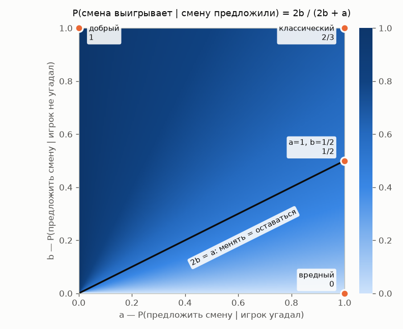
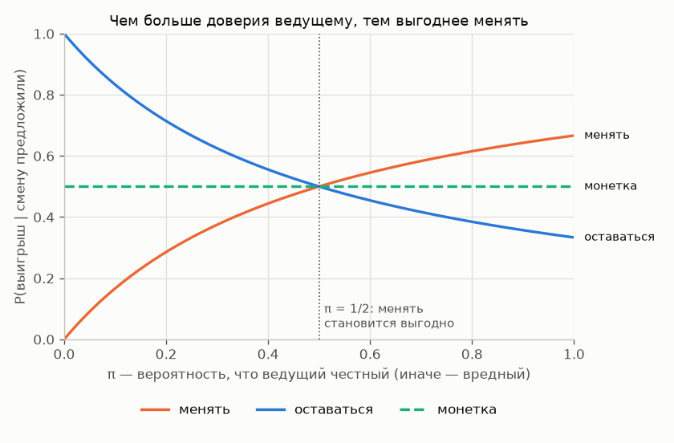

# Парадокс Монти Холла: вероятность зависит от того, как получено наблюдение

## Условие

В формулировке, которую Мэрилин вос Савант опубликовала в журнале Parade в 1990 году:

> Вы участвуете в телеигре, и вам предлагают выбрать одну из трёх дверей. За одной дверью автомобиль, за двумя другими — козы. Вы выбираете дверь, скажем, № 1, а ведущий, который знает, что за дверями, открывает другую дверь, скажем, № 3, за которой коза. Затем он говорит вам: «Не хотите ли выбрать дверь № 2?» Выгодно ли вам поменять выбор?

Классический ответ: менять, вероятность выигрыша 2/3. Но этот ответ верен только при определённых правилах, по которым действует ведущий. Об этом вся задача.

🎮 **[Сыграть в браузере](https://kogriv.github.io/Stata/problems/07_monty_hall/game/)**: пять типов ведущего и режим «угадай ведущего по его поведению».

## Классическое решение

Классическая постановка явно фиксирует **протокол ведущего**:

1. ведущий знает, где автомобиль;
2. он **всегда** открывает одну из двух невыбранных дверей, и всегда с козой;
3. если обе невыбранные двери с козами, он выбирает между ними случайно;
4. он **всегда** предлагает сменить выбор.

Пусть игрок выбрал дверь 1. Автомобиль равновероятно стоит за любой дверью:

| Где автомобиль | Вероятность | Что откроет ведущий | Оставаться | Менять |
|---|---|---|---|---|
| за дверью 1 | 1/3 | 2 или 3 | выигрыш | проигрыш |
| за дверью 2 | 1/3 | только 3 | проигрыш | выигрыш |
| за дверью 3 | 1/3 | только 2 | проигрыш | выигрыш |

«Оставаться» выигрывает в одной строке из трёх, «менять» — в двух: **1/3 против 2/3**.

То же самое по формуле Байеса. Пусть ведущий открыл дверь 3. Правдоподобие этого наблюдения при каждом положении автомобиля:

$$
P(\text{открыл }3 \mid \text{авто за }1) = \tfrac12, \quad
P(\text{открыл }3 \mid \text{авто за }2) = 1, \quad
P(\text{открыл }3 \mid \text{авто за }3) = 0,
$$

$$
P(\text{авто за }2 \mid \text{открыл }3) = \frac{\frac13 \cdot 1}{\frac13 \cdot \frac12 + \frac13 \cdot 1 + \frac13 \cdot 0} = \frac23.
$$

### Почему не 50/50

Две закрытые двери выглядят симметрично, но симметрии нет: ведущий открывал дверь **не случайно**. Свою дверь игрок выбрал вслепую, и шанс 1/3 у неё остаётся: ведущий открыл бы какую-то дверь с козой при любом её содержимом, так что о двери 1 его действие ничего не говорит. А вот вторая закрытая дверь — та, которую ведущий **не открыл, хотя мог**, и это информация.

### Монетка и «игра всего одна»

Есть соблазн рассуждать так: «Преимущество смены проявляется только на длинной серии игр. У меня одна попытка, значит, преимущество нереализуемо, и честнее бросить монетку». Это неверно:

- монетка — это смесь стратегий «оставаться» и «менять», поэтому она даёт $\frac12 \cdot \frac13 + \frac12 \cdot \frac23 = \frac12$, т.е. строго хуже, чем «менять»;
- 2/3 — это вероятность выиграть **в этой самой игре**, а не частота в серии. Серия нужна, только чтобы увидеть частоту своими глазами. Если вариант A даёт шанс 2/3, а вариант B — 1/2, то A лучше и в единственной попытке;
- исход здесь двоичный (машина или коза), поэтому никакое отношение к риску не сделает шанс 1/2 предпочтительнее шанса 2/3.

## Протокол ведущего решает всё

Ослабим самое сильное допущение: пусть ведущий **не обязан** предлагать смену. Обозначим:

- $a$ — вероятность, что ведущий предложит смену, если игрок **угадал** автомобиль;
- $b$ — вероятность, что он предложит смену, если игрок **не угадал**.

(Предлагая смену, ведущий по-прежнему открывает дверь с козой.) Тогда

$$
P(\text{смена выигрывает} \mid \text{смену предложили}) = \frac{\frac23 b}{\frac23 b + \frac13 a} = \frac{2b}{2b + a}.
$$

Менять выгодно, если $2b > a$. Само предложение — это сигнал о том, угадал ли игрок.

| Ведущий | $a$ | $b$ | Смена выигрывает |
|---|---|---|---|
| классический: предлагает всегда | 1 | 1 | **2/3** |
| «вредный»: предлагает, только если игрок угадал | 1 | 0 | **0** |
| «добрый»: предлагает, только если игрок ошибся | 0 | 1 | **1** |
| угадавшим предлагает вдвое чаще | 1 | 1/2 | **1/2** |



### Ведущий, который не знает, где автомобиль

Пусть ведущий открывает одну из двух невыбранных дверей **наугад**, и в этот раз там оказалась коза. Если бы там оказался автомобиль, игра бы сломалась, но этого не случилось. Правдоподобие наблюдения «открыл дверь 3, там коза»:

$$
P(\cdot \mid \text{авто за }1) = \tfrac12, \quad P(\cdot \mid \text{авто за }2) = \tfrac12, \quad P(\cdot \mid \text{авто за }3) = 0,
$$

поэтому оставшиеся две двери равновероятны: **1/2**. Картинка та же самая (две закрытые двери, одна открыта, за ней коза), а ответ другой, потому что другой процесс её породил. Это единственный естественный сценарий, где интуиция «осталось две двери — значит 50/50» верна.

### Ведущий с любимой дверью

Пусть ведущий знает, где автомобиль, и всегда предлагает смену, но когда игрок угадал и можно открыть любую из двух дверей, он открывает дверь 3 с вероятностью $q$. Если открыта дверь 3:

$$
P(\text{смена выигрывает} \mid \text{открыл }3) = \frac{1}{1 + q} \in \left[\tfrac12;\ 1\right].
$$

При $q = \frac12$ это классические 2/3. Пока ведущий **обязан** предлагать смену, менять никогда не хуже, чем оставаться: его предпочтения могут уменьшить выгоду от смены до нуля, но не сделать её убыточной.

## Если правила неизвестны

Пусть игрок меняет выбор с вероятностью $p$ (0 — «оставаться», 1 — «менять», ½ — «монетка»), а если смену не предложили, остаётся при своей двери. Полная вероятность выигрыша:

$$
W(p) = \frac13\Big[(1 - a) + a(1 - p)\Big] + \frac23\, b\, p = \frac{1 + p\,(2b - a)}{3}.
$$

Что делать, зависит от того, что игрок знает о ведущем.

**Минимакс: защититься от худшего.** Худший ведущий для любой стратегии — «вредный» ($a = 1$, $b = 0$), и против него $W(p) = \frac{1-p}{3}$:

| Стратегия | Гарантированный выигрыш |
|---|---|
| всегда оставаться | **1/3** |
| монетка | 1/6 |
| всегда менять | 0 |

Если ведущий может быть противником и игрок ничего не знает о его мотивах, безопасно **оставаться**. Цена такой страховки: против честного ведущего игрок отказывается от 2/3 ради 1/3.

**Байес: действовать по своей оценке.** Пусть с вероятностью $\pi$ ведущий классический, а с вероятностью $1 - \pi$ «вредный». Тогда $a = 1$, $b = \pi$ и

$$
P(\text{смена выигрывает} \mid \text{смену предложили}) = \frac{2\pi}{2\pi + 1}.
$$

Менять выгодно, если $\pi > \frac12$, т.е. если честный ведущий кажется вероятнее вредного.



Монетка не оптимальна ни при каком подходе: она лучшая только на грани $2b = a$, где все стратегии одинаковы.

## Что было в настоящем шоу

В 1991 году New York Times поговорила с самим Монти Холлом, ведущим «Let's Make a Deal» с 1963 по 1990 год (J. Tierney, [*Behind Monty Hall's Doors: Puzzle, Debate and Answer?*](https://www.nytimes.com/1991/07/21/us/behind-monty-hall-s-doors-puzzle-debate-and-answer.html), The New York Times, 21.07.1991).

Сначала Холл сыграл с журналистом 20 раундов по классическим правилам. Без смены выбора получилось 4 машины из 10, со сменой — 8 из 10. Вывод Холла: «So her answer's right: you should switch».

Потом он перечитал формулировку задачи, заметил лазейку и сыграл ещё 8 раундов, уже как ведущий настоящего шоу. Если игрок выбирал дверь с козой, Холл сразу открывал её и вручал козу. Если игрок угадывал, Холл предлагал смену. Это в точности «вредный» ведущий из таблицы выше. Холл выиграл все 8 раундов, а единственным способом получить машину было **не** менять выбор. Как пишет NYT, это не было нарушением правил шоу: у Холла было право не предлагать смену, и обычно он её не предлагал.

Мартин Гарднер: «The problem is not well-formed unless it makes clear that the host must always open an empty door and offer the switch. Otherwise, if the host is malevolent, … the probability of being right by switching could be as low as zero».

Перси Диаконис: «The strict argument would be that the question cannot be answered without knowing the motivation of the host».

И сам Монти Холл: «If the host is required to open a door all the time and offer you a switch, then you should take the switch. But if he has the choice whether to allow a switch or not, beware. Caveat emptor. It all depends on his mood».

## Причём здесь анализ данных

В задаче наблюдение одно и то же — две закрытые двери и коза за открытой, — а правильные ответы лежат от 0 до 1, в зависимости от того, по какому правилу ведущий решал, что показать. В данных такой «ведущий» есть почти всегда:

- **рекомендательные системы**: в логах есть реакции только на то, что система сама решила показать. Модель, обученная на этих логах как на случайной выборке, учится на собственных решениях;
- **ошибка выжившего**: в выборку попадают только объекты, прошедшие отбор, — работающие компании, вернувшиеся клиенты, ответившие на опрос;
- **пропуски в данных**: если значение пропущено тем чаще, чем оно больше (доход в анкете), среднее по заполненным строкам смещено;
- **A/B-тесты без рандомизации**: если пользователь сам выбирает, в какую группу попасть, разница между группами смешивает эффект и отбор.

Во всех этих случаях вопрос «как данные попали в выборку» не менее важен, чем сами данные.

## Проверка

```
python problems/07_monty_hall/solution.py           # теория и симуляция для всех ведущих и стратегий
python problems/07_monty_hall/solution.py --plots   # плюс перерисовать картинки (нужен matplotlib)
```
